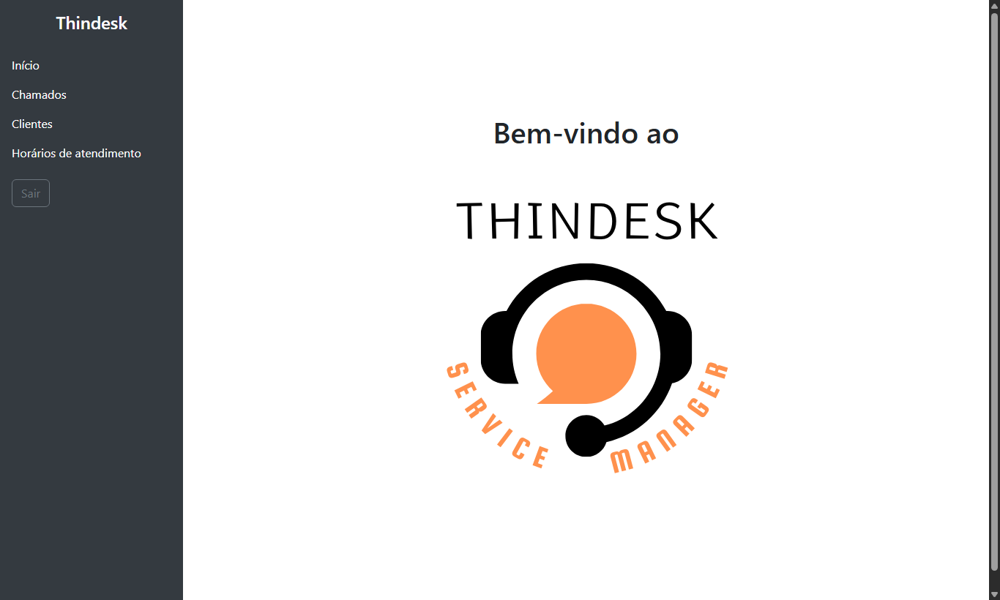

# Thindesk

Sistema web de chamados técnicos com Spring Boot, Thymeleaf e MongoDB. Permite abrir, acompanhar e resolver chamados.

## Demonstração

Acesse [Thindesk no Railway](https://thindesk-production.up.railway.app/login).

- Usuário: `demo`
- Senha: `ThindeskDemo!2026`

A conta é compartilhada e pode abrir e consultar os chamados de demonstração. Use dados fictícios.

## Dashboard



## Versão

A versão `1.0.1-beta` está definida no [pom.xml](pom.xml). Esta versão inclui a publicação do ambiente de demonstração.

O formato é `MAJOR.MINOR.PATCH`. O primeiro número muda quando há quebra de compatibilidade na API. O segundo indica novas funcionalidades compatíveis e o terceiro, correções compatíveis. O sufixo `-beta` identifica um pré-lançamento. [SemVer 2.0.0](https://semver.org/lang/pt-BR/)

## Execução local

Requisitos: Java 17 e MongoDB. Com o MongoDB ativo, execute no PowerShell:

```powershell
$env:MONGODB_URI = "mongodb://localhost:27017/thindesk"
$env:ADMIN_USER = "admin"
$env:ADMIN_PASSWORD = "defina-uma-senha-forte"
.\mvnw.cmd spring-boot:run
```

Acesse [localhost:8080/login](http://localhost:8080/login). A senha cria o administrador na primeira execução. Use uma senha própria de pelo menos 12 caracteres. Para gerar o JAR, execute `.\mvnw.cmd package`. O arquivo será gerado em `target/thindesk-1.0.1-beta.jar`.

## Perfis

- `USUARIO` abre e consulta os próprios chamados.
- `TECNICO` consulta todos os chamados e resolve os que estão sem técnico ou atribuídos a ele.
- `ADMIN` tem as permissões de técnico e também gerencia contas, clientes e horários.

## API

A autenticação usa sessão. Antes do login, obtenha o token em `GET /api/auth/csrf` e envie-o como `_csrf` no formulário. Após o login, obtenha um novo token e envie-o no cabeçalho retornado pelo endpoint nas requisições de escrita.

| Método | Rota | Função |
|---|---|---|
| GET | /api/auth/csrf | Obter token CSRF (público; não dá acesso a dados) |
| POST | /login | Autenticar com formulário username/password/_csrf |
| POST | /logout | Encerrar sessão (exige CSRF) |
| GET | /api/auth/me | Identificar sessão |
| POST | /api/usuarios | Criar conta (ADMIN) |
| GET/POST | /api/chamados | Listar/abrir chamados |
| GET | /api/chamados/{id} | Consultar chamado com controle de acesso |
| GET | /api/chamados/usuario/{login} | Consultar chamados por login |
| PUT | /api/chamados/{id}/resolver | Registrar solução e técnico autenticado |
| GET/POST | /api/clientes | Listar/criar clientes (ADMIN) |
| GET/POST | /api/ajustes-horarios | Listar/salvar horários (ADMIN) |
| DELETE | /api/ajustes-horarios/{id} | Excluir horário (ADMIN) |

## Testes

Execute `.\mvnw.cmd test`. Os testes usam repositórios simulados e cobrem autenticação, CSRF, validação e permissões. Para verificar a persistência, abra um chamado como usuário, resolva-o como técnico e consulte o resultado com o MongoDB ativo.

## Base existente

Faça backup antes de atualizar. Em chamados antigos, associe os campos `usuario` e `tecnico` aos logins correspondentes e inicialize o campo de controle de concorrência no `mongosh`.

```javascript
db.chamados.updateMany({ versao: { $exists: false } }, { $set: { versao: NumberLong(0) } })
```

Contas precisam de login único, senha em BCrypt e um dos perfis listados acima.
